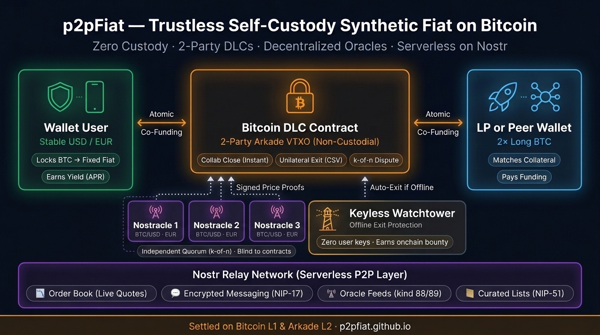
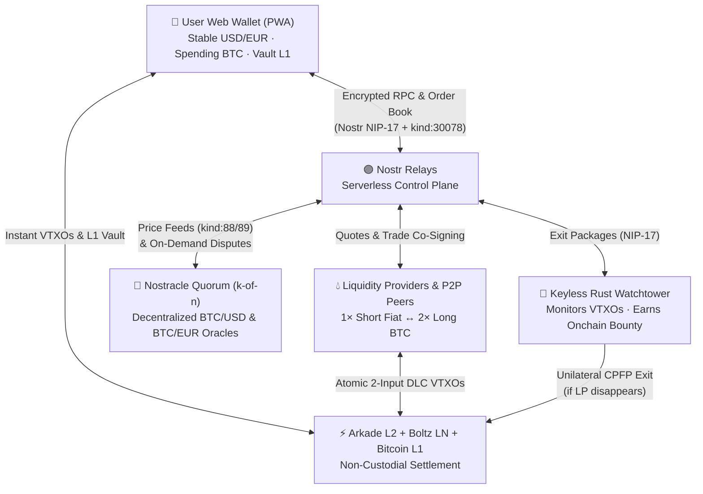
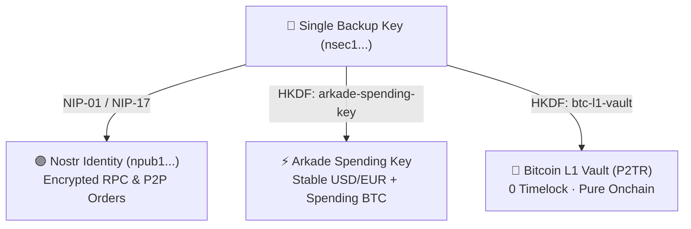
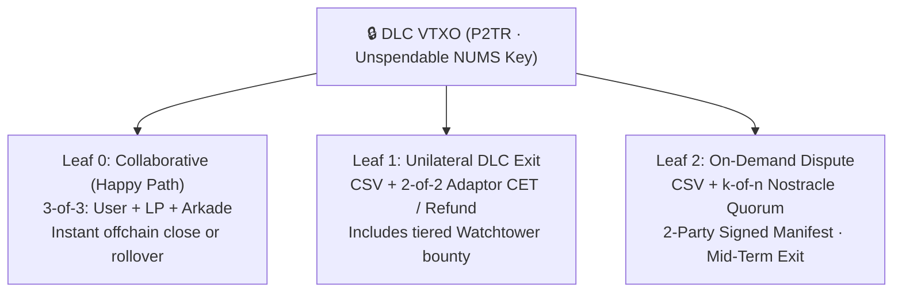
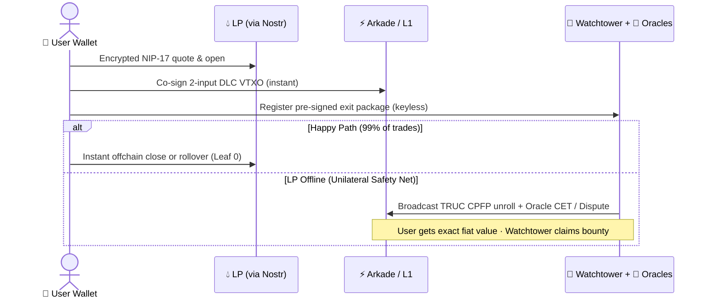
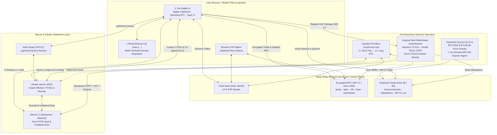
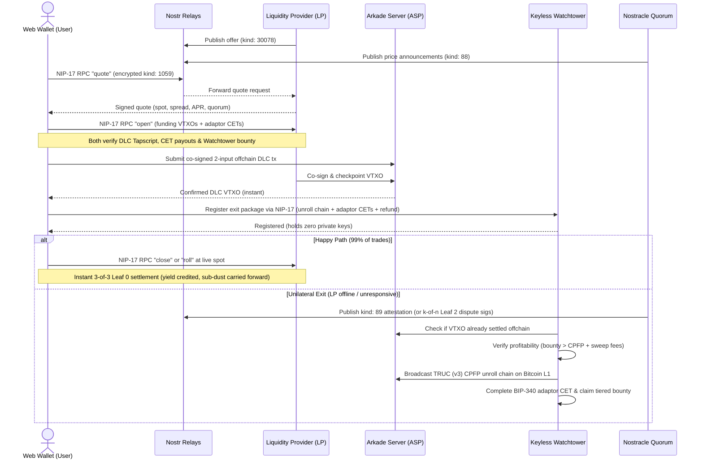

# p2pFiat — Trustless, Self-Custody Synthetic USD & EUR on Bitcoin (Arkade + DLCs + Nostr)

> **Humanity deserves a trustless, permissionless digital fiat currency.**



**p2pFiat** is a self-custody, Bitcoin-collateralized synthetic fiat (USD / EUR) and 2× leveraged BTC protocol built on **[Arkade](https://arkadeos.com/)** (Bitcoin L2 VTXOs), **Discreet Log Contracts (DLCs)**, and **Nostr**.

- **Zero custody:** Neither the Liquidity Provider (LP), the Arkade server, the price oracles (**Nostracles**), nor the **Watchtower** ever holds user keys or can steal funds.
- **100% browser-native PWA:** Live Mutinynet demo at **[https://p2pfiat.github.io/](https://p2pfiat.github.io/)** — runs completely client-side with **NIP-07 Nostr Extension login** (Alby / nos2x + portable NIP-44 encrypted seed) or a single `nsec1…` backup key.
- **Serverless P2P discovery & RPC:** LPs and peer-to-peer makers publish quotes via Nostr (`kind: 30078`) and negotiate contracts over encrypted **NIP-17** Gift Wraps (`kind: 1059`).
- **Offline safety net:** A **keyless Rust `ark-watchtower`** monitors contracts and executes pre-signed TRUC (v3) CPFP unilateral exits for a tiered onchain bounty if a counterparty disappears.

---

## Visual Architecture Overview

### 1. System Overview (High-Level)



---

### 2. Three-Tier Self-Custody & Portable Login (NIP-07 Extension or `nsec1…`)

Sign in with a **Nostr Extension (NIP-07: Alby / nos2x)** — where your `nsec` never leaves the extension and a 32-byte `walletSeed` is NIP-44 encrypted to your own `npub` (`kind: 30078`, `d: "p2pfiat-wallet-seed-v1"`) — or create/restore a single `nsec1…` backup key without any extension. From that seed, all wallet keys are deterministically derived offline via **HKDF-SHA256** (`salt = "p2pfiat/v1"`) with strict domain separation, so your Nostr `npub`, Arkade key, and L1 Vault key are **cryptographically unlinkable**.



In the mobile-first Web Wallet, funds flow vertically between the 3 custody tiers:

1. **🛡 Stable USD / EUR (Top):** Synthetic fiat backed 1:1 by BTC inside a 2-party Arkade DLC VTXO, accruing daily carry yield (`APR`). Supports instant `Receive` (auto-stabilize incoming sats) and `Send` (auto-liquidate soonest-expiring positions + optional change re-lock).
2. **⚡ Spending BTC (Middle):** Instant, zero-fee Arkade VTXOs + Boltz Lightning VHTLC swaps. Connected to Stable via `↑ To USD/EUR` / `↓ To Sats`.
3. **🏦 Bitcoin Vault (Bottom):** Pure onchain Taproot (`tb1p…` / `bc1p…`) with **0 timelock** and zero Arkade ASP dependency. Connected to Spending via `↑ To Spending` / `↓ To Vault`.

---

### 3. Arkade DLC Taproot Script Tree (3 Spending Paths)

Every locked position (`Stable USD/EUR` or `2× Long BTC`) is a 2-party custom Tapscript VTXO with an unspendable BIP-341 NUMS internal key:



> **Mainnet-hardened Leaf 2 security:** Every Leaf 2 dispute is bound to a **2-party BIP-340 signed Contract Manifest** (`p2pfiat/dispute-manifest/v1`) committing both payout scripts, outpoint, notional, and funding rate. Each Nostracle independently deserializes `raw_tx_hex`, verifies both signatures and payouts within a ±1% volatility band (plus bounded L1 miner fee + optional tiered NUMS P2TR Watchtower bounty), and recomputes the BIP-342 Tapscript sighash before signing. Both LP trades and browser-to-browser P2P matches support Leaf 2 `⚡ Force Exit` and autonomous `ark-watchtower` execution.

---

### 4. Trade, Rollover & Watchtower Safety Flow



<details>
<summary>🔍 <strong>Detailed Architecture Diagrams (expand for full protocol &amp; component view)</strong></summary>

#### Detailed Component & Protocol Map



#### Detailed Sequence Flow



</details>

---

## Repository Structure

| Directory / Repo | Description | Documentation |
|---|---|---|
| [`mvp/web/`](mvp/web/) | Browser-native Self-Custody Web Wallet PWA (Vite + `@arkade-os/sdk` + `@arkade-os/boltz-swap`) | [mvp/web/README.md](mvp/web/README.md) |
| [`mvp/`](mvp/) | Liquidity Provider daemon (`lp.mjs`), DLC contract builder (`contract.mjs`), NIP-17 RPC (`nip17.mjs`), Order Book (`offerbook.mjs`), CLI & E2E tests | [mvp/README.md](mvp/README.md), [mvp/OFFERBOOK_PROTOCOL.md](mvp/OFFERBOOK_PROTOCOL.md) |
| [`watchtower/`](watchtower/) | Keyless Rust `ark-watchtower` with tiered P2TR bounties, TRUC CPFP unrolling, and NIP-17 intake | [watchtower/README.md](watchtower/README.md), [watchtower/ORACLE_INCENTIVES.md](watchtower/ORACLE_INCENTIVES.md) |
| [`nostracle`](https://github.com/p2pfiat/nostracle) *(sibling repo)* | Rust DLC price oracle (kinds 88/89, paid NIP-57 zaps, On-Demand BIP-342 Dispute Signer) | `nostracle/README.md` |
| [`experiments/`](experiments/) | 19 incremental protocol & live Mutinynet experiments (offline settlement, threshold oracles, watchtower bounties, unilateral exits, perpetual rolls) | [experiments/19-mutinynet-perpetual-and-failed-rolls/README.md](experiments/19-mutinynet-perpetual-and-failed-rolls/README.md) |
| [`docs/`](docs/) | Deep-dive protocol specifications and Arkade architecture notes | [`docs/`](docs/) |

---

## Quick Start (Local Mutinynet Stack)

### 1. Run the Web Wallet locally
```bash
npm --prefix mvp/web install
npm --prefix mvp/web run dev
# Open http://localhost:5173
```

### 2. Run a Liquidity Provider (LP)
```bash
npm --prefix mvp install

# LP-Alpha (HTTP + NIP-17 P2P, 10 bps spread, +2 bps/day yield)
LP_PORT=3456 LP_NAME=LP-Alpha LP_SPREAD_BPS=10 LP_FUNDING_BPS=2 LP_DATA_DIR=mvp/data/lp-alpha node mvp/src/lp.mjs

# LP-Beta (Pure serverless NIP-17 P2P, 5 bps spread, +3.5 bps/day yield)
LP_NO_HTTP=1 LP_NAME=LP-Beta LP_SPREAD_BPS=5 LP_FUNDING_BPS=3.5 LP_DATA_DIR=mvp/data/lp-beta node mvp/src/lp.mjs
```

### 3. Run the Keyless Rust Watchtower
```bash
cd watchtower
cp config.example.toml config.toml
cargo run -- init   # generates watchtower key & prints P2TR funding address
cargo run -- run    # listens for NIP-17 exit packages & monitors Nostracles
```

### 4. Run Tests
```bash
# Protocol unit & compatibility tests (contract, NIP-17, orderbook, on-demand dispute, watchtower compat)
node --test mvp/test/nip17.test.mjs mvp/test/offerbook.test.mjs mvp/test/nostracle-kind88.test.mjs mvp/test/ondemand-dispute.test.mjs mvp/test/watchtower-compat.test.mjs

# Watchtower Rust tests (including paid oracle dispute flow)
cd watchtower && cargo test
```

---

## Security & Trust Model

| Component | Holds User Funds? | What if it goes offline or turns malicious? |
|---|---|---|
| **Liquidity Provider (LP)** | No | User (or Watchtower) unrolls VTXO onchain via Leaf 1 (adaptor CET) or Leaf 2 (k-of-n Nostracle dispute). |
| **Arkade Server (ASP)** | No | Every VTXO has a pre-signed onchain exit path; L1 Bitcoin Vault has 0 timelock and zero ASP involvement. |
| **Watchtower** | No (zero user/LP keys) | Cannot steal funds; can only broadcast pre-signed exits to earn its tiered bounty. Backup watchtowers step in after `backup_csv` blocks. |
| **Nostracles (k-of-n)** | No | Threshold quorum (`k-of-n`, e.g. 3-of-5) prevents any single oracle from manipulating price; if quorum fails, timelocked refund returns collateral. |
| **Nostr Relays** | No | Multi-relay broadcast (5 default relays) + end-to-end NIP-44 / NIP-17 encryption; users can configure custom relays at any time. |

---

## Vision: The Future Risk-Free Rate

Because the expected long-term return of BTC priced in fiat is positive in most market regimes, leveraged long counterparties pay a carry fee (funding rate) to synthetic fiat holders. Over time, fully collateralized, trustless BTC-backed fiat stability establishes a **native Bitcoin risk-free rate** — yield without sovereign or intermediary counterparty risk.

## Inspiration & Prior Art

- [Discreet Log Contracts (DLCs)](https://adiabat.github.io/dlc.pdf) — Tadge Dryja
- [Ark Protocol / Arkade](https://arkadeos.com/) — Offchain Bitcoin VTXOs with unilateral exits
- [Galoy Stablesats](https://stablesats.com/) — Original inspiration for BTC-backed synthetic USD in Bitcoin wallets
- [10101](https://10101.finance/), [Ben Carman](https://github.com/benthecarman), [Juraj Bednár & René Pickardt (LN-DLC)](https://hackmd.io/@lpQxZaCeTG6OJZI3awxQPQ/LN-DLC), [kormir](https://crates.io/crates/kormir), and [VweTS (ePrint 2022/499)](https://eprint.iacr.org/2022/499)

## License

Licensed under the **Business Source License 1.1 (BSL 1.1)** — see [`LICENSE`](LICENSE). Non-commercial use, auditing, and testnet/Mutinynet operation are permitted; commercial production use requires a separate license from `p2pFiat`. Converts automatically to **AGPL-3.0** on `2030-11-26`.

---

*Follow updates on [X (@p2pfiat)](https://x.com/p2pfiat) and [Nostr](https://primal.net/p/npub1p2ppegcr9j875e2d76vzn9za9s3rd6npgvde8d5cwjza8c80en3sj72l43).*
