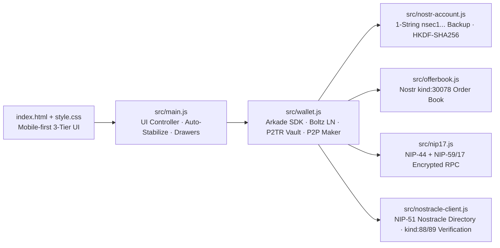

# p2pFiat Web Wallet PWA (`mvp/web`)

A 100% client-side, self-custody Progressive Web App for holding **Stable USD / EUR**, **Spending BTC** (Arkade + Lightning), and an onchain **Bitcoin Vault (L1)** directly in the browser.

- **Live Mutinynet Demo:** [https://p2pfiat.github.io/](https://p2pfiat.github.io/)
- **Zero backend required:** Talks directly to the Arkade ASP (`https://mutinynet.arkade.sh`), Boltz Lightning VHTLC swaps (`@arkade-os/boltz-swap`), Esplora (`https://mutinynet.com/api`), and Nostr relays.

---

## Architecture & Module Map



| File | Responsibility |
|---|---|
| [`index.html`](index.html) & [`src/style.css`](src/style.css) | Mobile-first 3-tier vertical layout (**Stable USD/EUR** ↔ **Spending BTC** ↔ **Bitcoin Vault L1**), contextual drawers, collapsible Lock / Positions / Recent Activity sections, and Settings. |
| [`src/main.js`](src/main.js) | UI state, live spot & yield ticker, dummy-proof Stable `Receive` (auto-stabilize incoming sats) & Stable `Send` (auto-liquidate soonest-expiring positions + optional change re-lock), Unified BIP-21 QR codes, and Order Book / P2P Maker UI. |
| [`src/wallet.js`](src/wallet.js) | Self-custody core: `@arkade-os/sdk` VTXO management, `@arkade-os/boltz-swap` Lightning send/receive, pure L1 P2TR Vault signing (`@scure/btc-signer`), DLC contract co-signing, automatic Watchtower registration, and browser-to-browser P2P Maker RPC. |
| [`src/nostr-account.js`](src/nostr-account.js) | Unified `nsec1…` backup key management & domain-separated HKDF-SHA256 derivation (`salt="p2pfiat/v1"`, `info="arkade-spending-key"` and `info="btc-l1-vault"`), plus optional Nostr profile (`kind: 0`) sync. |
| [`src/offerbook.js`](src/offerbook.js) | Multi-relay Nostr `kind: 30078` order book discovery and maker offer publishing (5 default relays). |
| [`src/nip17.js`](src/nip17.js) | Pure ESM NIP-44 v2 + NIP-59/17 Gift-Wrapped encrypted RPC peer for serverless LP & Watchtower communication. |
| [`src/nostracle-client.js`](src/nostracle-client.js) | Reads the curated NIP-51 `kind: 30000` (`d: "p2pfiat-nostracles"`) oracle list, scans live Nostracle reputation (`kind: 88/89/1`), verifies kormir adaptor points, and supports user-added custom Nostracles. |

---

## Key Features

- **1-String Backup (`nsec1…`):** One Nostr private key deterministically restores your Nostr identity, Arkade Spending wallet, and pure L1 Bitcoin Vault offline via HKDF-SHA256 — with cryptographic unlinkability between all three public keys.
- **3-Tier Self-Custody:**
  1. **🛡 Stable USD / EUR:** Synthetic fiat locked in 2-party Arkade DLCs, earning daily carry yield.
  2. **⚡ Spending BTC:** Instant Arkade VTXOs + Boltz Lightning VHTLC invoices via Unified BIP-21 QR (`bitcoin:<vault>?ark=<tark1>&lightning=<bolt11>`).
  3. **🏦 Bitcoin Vault (L1):** Pure single-key P2TR onchain address (`0` timelock, never expires).
- **2× Long BTC & P2P Maker Orders:** Take leveraged long BTC positions or post your own P2P maker order directly from the browser.
- **Keyless Watchtower Sync:** Automatically exports and registers pre-signed exit packages with the configured `ark-watchtower` pubkey over NIP-17.
- **Custom Nostracles:** Inspect live oracle uptime/reputation or add your own Nostracle `npub1…` under *Settings → Advanced*.

---

## Development & Build

```bash
npm --prefix mvp/web install
npm --prefix mvp/web run dev    # Dev server at http://localhost:5173
npm --prefix mvp/web run build  # Static production bundle in mvp/web/dist/
```

The production bundle uses relative paths (`base: "./"` in [`vite.config.js`](vite.config.js)), so `mvp/web/dist/` can be hosted on any static host (GitHub Pages, Cloudflare Pages, IPFS, or localhost).
